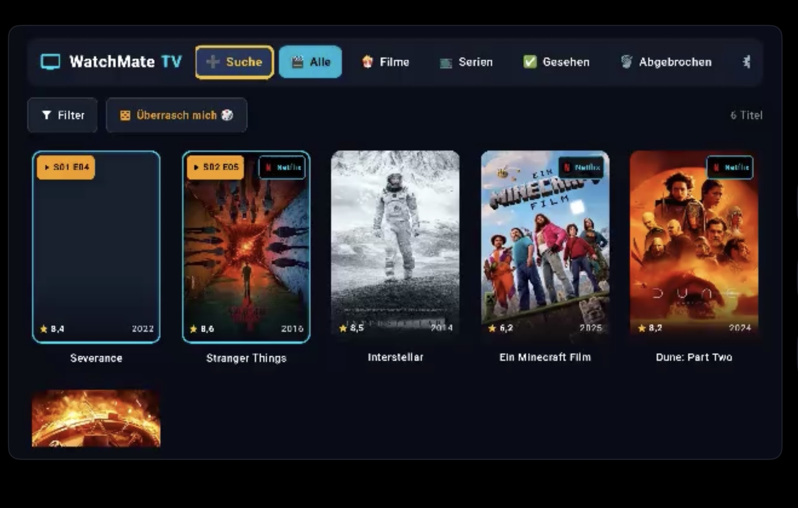
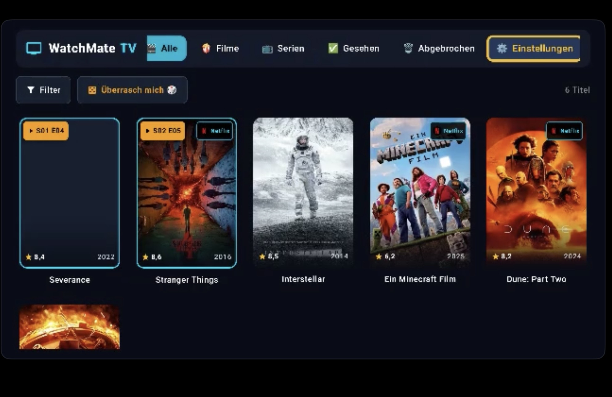

# 📺 WatchMate TV

> **Die smarte, lokale Film- und Serien-Watchlist für Android TV & Google TV.**  
> Entwickelt mit modernstem **Kotlin & Jetpack Compose for TV**, nativer Fernbedienungs-Navigation (D-Pad), TMDb-Echtzeitsuche und automatischer Erkennung deiner Streaming-Abonnements (Netflix, Prime, Disney+, WOW u.v.m.).

---


---

## 🌟 Highlights & Funktionen

- 🎮 **100% D-Pad-optimiert (Fernbedienung):** Speziell für die Couch-Experience auf TV-Bildschirmen (z. B. Philips OLED, Sony Bravia, Chromecast mit Google TV, Nvidia Shield). Flüssige Spring-Animationen, prominente Gold-Rahmen und Z-Achsen-Fokus ohne abgeschnittene Kanten.
- 🎬 **TMDb-Suche & Metadaten:** Durchsuche Millionen von Filmen und TV-Serien mit weltweiten Metadaten: Offizielle deutsche Inhaltsangaben, Veröffentlichungsjahre, Bewertungen, hochauflösende Filmplakate und Trailer (YouTube).
- 🍿 **Streaming-Anbieter & Abo-Erkennung:**
  - Automatische Anzeige, wo ein Film oder eine Serie in deiner Region (**Deutschland 🇩🇪, Österreich 🇦🇹, Schweiz 🇨🇭**) gestreamt werden kann.
  - **Eigene Abonnements filtern:** Markiere deine aktiven Anbieter (Netflix, Amazon Prime Video, Disney+, WOW / Sky, Apple TV+, Paramount+, RTL+, Joyn, MagentaTV, Crunchyroll). WatchMate TV hebt passende Flatrates farblich hervor.
- 🚀 **Direkter App-Start (Deep Links):** Öffne den ausgewählten Titel mit einem Klick direkt in der installierten Streaming-App auf deinem TV.
- 📺 **Serien- & Episoden-Tracker:**
  - Verfolge deinen aktuellen Stand (z. B. *Staffel 2, Episode 5*).
  - Ein Klick auf *"Nächste Episode"* zählt automatisch weiter und wechselt nahtlos zur nächsten Staffel.
  - Dialog zur Fertigstellung beim Erreichen des Serienfinales.
- 🎲 **"Überrasch mich" & Filter:** Finde blitzschnell den passenden Film für den Abend nach Genre, maximaler Laufzeit (z. B. < 90 Min.) oder lass den Zufallsgenerator entscheiden.
- 🔒 **100% Lokal & Datenschutzfreundlich:** Alle Listen und der Serienfortschritt werden in einer lokalen **Room-SQLite-Datenbank** auf deinem TV gespeichert. Kein Login, kein Tracking, kein Cloud-Zwang.
- 📥 **Beispieldaten mit 1 Klick:** Starte sofort durch – auf Knopfdruck lässt sich eine kuratierte Liste beliebter Titel (*Severance, Stranger Things, Dune 2, Arcane, Inception, Breaking Bad*) laden.

---

## 📸 Screenshots

| Hauptübersicht & Fokus-Navigation | Filter & Streaming-Anbieter |
| :---: | :---: |
|  |  |

---

## 📥 Installation (APK Download)

Die vorab kompilierte Installationsdatei befindet sich direkt im Hauptverzeichnis dieses Repositories:

➡️ **[`WatchMate-TV.apk`](./WatchMate-TV.apk)** (oder [`app-debug.apk`](./app-debug.apk))

### Installation auf Android TV / Google TV:
1. Lade die Datei `WatchMate-TV.apk` herunter.
2. Installiere die APK auf deinem Android TV über eine der folgenden Methoden:
   - **Per USB-Stick:** Kopiere die Datei auf einen USB-Stick und öffne sie auf dem TV mit einem Datei-Manager (z. B. *File Commander* oder *AnExplorer*).
   - **Per App "Send Files to TV":** Übertrage die APK vom Smartphone/PC direkt an den TV.
   - **Per ADB (Kabellos / USB):**
     ```bash
     adb connect <TV-IP-ADRESSE>:5555
     adb install -r WatchMate-TV.apk
     ```

---

## 🛠️ Tech-Stack & Architektur

Die App wurde von Grund auf nach modernen Android- und Google-TV-Best-Practices entwickelt:

- **Architektur:** MVVM (Model-View-ViewModel) mit sauberer Trennung von UI, Repository und Data-Sources.
- **UI Toolkit:** Jetpack Compose (Material 3 for TV) mit `tv-foundation` und responsiven LazyGrids.
- **Asynchronität:** Kotlin Coroutines & `StateFlow` / `collectAsStateWithLifecycle`.
- **Lokale Datenbank:** Android Jetpack Room (SQLite) mit automatischen Migrationen.
- **Netzwerk & API:** Retrofit 2 mit Moshi-JSON-Converter und OkHttp-Logging.
- **Bildanzeige:** Coil (AsyncImage) mit integriertem Bitmap-Caching.
- **Konfiguration:** Secrets Gradle Plugin für API-Keys via `.env` und `.env.example`.

---

## ⚙️ TMDb API-Konfiguration (Optional)

WatchMate TV enthält bereits vorkonfigurierte Beispieldaten und einen kuratierten Offline-Katalog. Für unbegrenzte weltweite Live-Suchen und tagesaktuelle Streaming-Rechte:

1. Hole dir einen kostenlosen API-Key auf [themoviedb.org](https://www.themoviedb.org/).
2. Trage ihn entweder direkt in der TV-App unter **Einstellungen ⚙️ ➔ TMDb API-Konfiguration** ein oder lege ihn vor dem Bauen in einer `.env`-Datei an:
   ```properties
   TMDB_API_KEY=dein_api_key_hier
   TMDB_READ_ACCESS_TOKEN=dein_access_token_hier
   ```

---

## 💻 Selbst bauen (Entwicklung)

### Voraussetzungen
- Android Studio Ladybug / Meerkat oder neuer
- JDK 17 oder JDK 21
- Android SDK 36 (minSdk 24)

### Build per Befehlszeile:
```bash
# Debug-Build erstellen
gradle assembleDebug

# Tests ausführen
gradle :app:testDebugUnitTest
```
Die erzeugte APK liegt anschließend unter `app/build/outputs/apk/debug/app-debug.apk`.

---

## 📄 Lizenz

Dieses Projekt ist unter der [MIT License](LICENSE) lizenziert.
Metadaten und Bilder werden über die [TMDb API](https://www.themoviedb.org/) bereitgestellt (dieses Produkt nutzt die TMDb API, wird aber von TMDb weder unterstützt noch zertifiziert).
